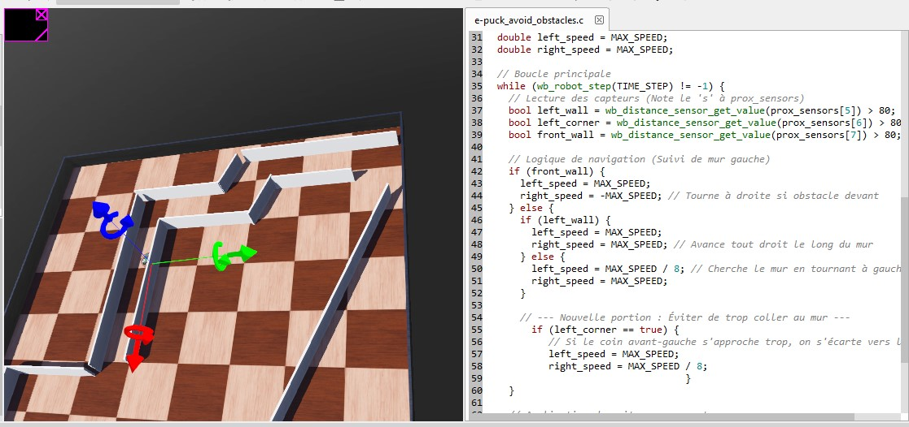

# 🤖 Autonomous Wall-Following Robot — Webots

### Autonomous Mobile Robot Navigation Using C Programming and Proximity Sensors

**Author:** Leroy Makita Loubaki  
**Project Type:** Mobile Robotics & Autonomous Navigation  
**Engineering Program:** ESIGELEC — DARIA

---

## 📖 1. Project Overview

This project explores autonomous mobile robot navigation using **Webots**, a robotics simulation environment.

The objective is to implement a **left-wall-following algorithm** that enables a differential-drive robot to navigate a maze-like environment using proximity sensor measurements.

The project combines:

- Mobile robotics
- C programming
- Proximity sensor integration
- Differential-drive control
- Reactive autonomous navigation
- Robotics simulation

The navigation algorithm uses predefined rules to adjust wheel velocities according to nearby obstacles.

## 🎯 2. Project Objectives

- Implement autonomous navigation in Webots.
- Use proximity sensors to detect walls and obstacles.
- Develop a left-wall-following control strategy.
- Avoid frontal collisions.
- Adjust wheel velocities according to sensor readings.
- Evaluate robot behavior in a simulated maze.

## 🛠️ 3. Technologies Used

| Category | Technology |
|---|---|
| Robotics Simulation | Webots |
| Programming Language | C |
| Robot Platform | e-puck |
| Sensors | Infrared Proximity Sensors |
| Actuation | Differential-Drive Wheels |
| Control Strategy | Rule-Based Wall Following |
| Navigation | Reactive Obstacle Avoidance |

## ⚙️ 4. System Architecture

The system follows a sensor-based control architecture:

**Proximity Sensors → Obstacle Detection → Navigation Decision → Wheel Velocity Commands**

The robot continuously reads selected proximity sensors and adjusts its left and right wheel velocities.

## 📡 5. Proximity Sensor Configuration

The Webots e-puck robot provides eight proximity sensors, identified as `ps0` through `ps7`.

The current controller uses three sensors:

| Sensor | Role |
|---|---|
| `ps5` | Left-side wall detection |
| `ps6` | Front-left corner detection |
| `ps7` | Front obstacle detection |

A sensor threshold of `80` is used to determine whether an obstacle is detected.

The threshold is specific to the simulation configuration and may require adjustment for other environments.

## 🧠 6. Wall-Following Algorithm

The controller implements a reactive left-wall-following strategy.

### Navigation Rules

**Case 1 — Obstacle Ahead**

When the front sensor detects an obstacle, the robot turns right by driving its wheels in opposite directions.

**Case 2 — Left Wall Detected**

When a wall is detected on the left side and no obstacle is detected ahead, both wheels rotate at equal speed, allowing the robot to move forward.

**Case 3 — Left Wall Missing**

When the left wall is no longer detected, the robot turns left by reducing the left-wheel velocity while maintaining a higher right-wheel velocity.

**Case 4 — Front-Left Corner Too Close**

When the front-left sensor detects a nearby obstacle, the robot adjusts its wheel velocities to steer away from the wall.

### Control Parameters

| Parameter | Value |
|---|---|
| Simulation Time Step | 64 ms |
| Maximum Wheel Speed | 6.28 rad/s |
| Proximity Detection Threshold | 80 |
| Reduced Wheel Speed | MAX_SPEED / 8 |

The controller uses fixed decision rules rather than machine learning or PID control.

## 💻 7. C Programming

The implementation uses the Webots C API.

Key functions include:

- `wb_robot_init()` — Initializes the robot controller.
- `wb_robot_get_device()` — Retrieves motor and sensor references.
- `wb_distance_sensor_enable()` — Enables proximity sensor measurements.
- `wb_distance_sensor_get_value()` — Reads proximity sensor values.
- `wb_motor_set_velocity()` — Applies wheel velocity commands.
- `wb_robot_step()` — Advances the simulation.
- `wb_robot_cleanup()` — Releases resources when the controller exits.

## 🖼️ 8. Simulation Environment

The robot is placed in a maze-like environment with walls and narrow passages.

### Webots Simulation Screenshot



## 🎥 9. Demonstration Video

A recorded demonstration of the wall-following simulation is provided below.


[▶ Watch the demonstration](videos/suiveur_mur(1).mp4)


The video illustrates the behavior of the controller in the simulated environment.

## 📁 10. Repository Structure

```text
webots-autonomous-wall-following/
├── README.md
├── controllers/
│   └── e-puck_avoid_obstacles/
│       └── e-puck_avoid_obstacles.c
├── images/
│   └── webots_simulation.jpg
├── videos/
│   └── wall_following_demo.mp4
└── worlds/
    └── simulation_world.wbt
```

*This structure represents the intended repository organization. The Webots world file will only be included if available.*

## ⚠️ 11. Limitations

- Navigation relies on fixed sensor thresholds.
- The controller does not perform global path planning.
- Sharp corners and complex wall geometries may require additional tuning.
- The robot does not build an environment map.
- Performance metrics such as traversal time and collision count have not yet been documented.

## 🚀 12. Future Improvements

- Implement PID-based wall-distance regulation.
- Improve corner detection.
- Introduce adaptive sensor thresholds.
- Compare reactive control with path-planning algorithms.
- Evaluate navigation performance across multiple maze configurations.
- Explore implementation on a physical mobile robot.

## 👨‍💻 13. Author

**Leroy Makita Loubaki**

Engineering Student — ESIGELEC, DARIA  
Engineering Apprentice — Constellium

Interested in Robotics, Autonomous Systems, Embedded Programming, Artificial Intelligence and Industrial Automation.

## 🌐 Connect With Me

[LinkedIn](https://www.linkedin.com/in/leroy-makita-loubaki-a78792290/) · [TikTok](https://www.tiktok.com/@kingtronix5) · [YouTube](https://youtube.com/@leroymakitaloubaki)

---

*Personal Mobile Robotics & Autonomous Navigation Project.*
